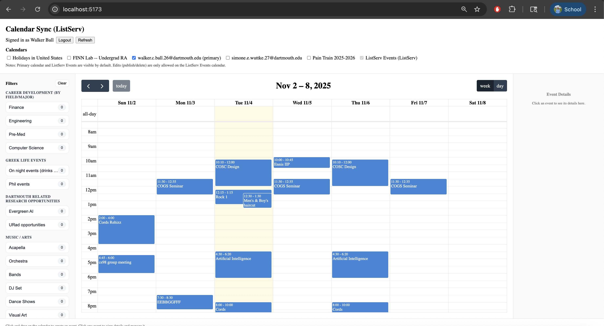

# We Run the School

<!--TODO: short project description, some sample screenshots or mockups-->
A public online events calendar focused on organizing Dartmouth Events in a centralized and easy to use website.

## Architecture

<!--TODO:  descriptions of code organization and tools and libraries used-->

## Setup

<!--TODO: how to get the project dev environment up and running, npm install etc-->
After cloning the main "project-we-run-the-school" repository:
1. cd into server and run "npm install" making sure that node.js is not a later verson than 22
2. cd into client and run "npm install" with the same node.js version
3. cd into server and run "npm run dev" making sure the terminal outputs "server is listening on port 3000"
4. with the server running in it's own terminal, create a new terminal window, cd into client and "npm run dev"
5. Command click "Local:   http://localhost:5173/" to open the calender on your browser

## Deployment

TODO: how to deploy the project

## Authors

Bill Zheng, Christian Nyamekye, Lydia Jin, Lorenzo Cuellar, Memo Tangtipongkul, Walker Ball

## Acknowledgments
